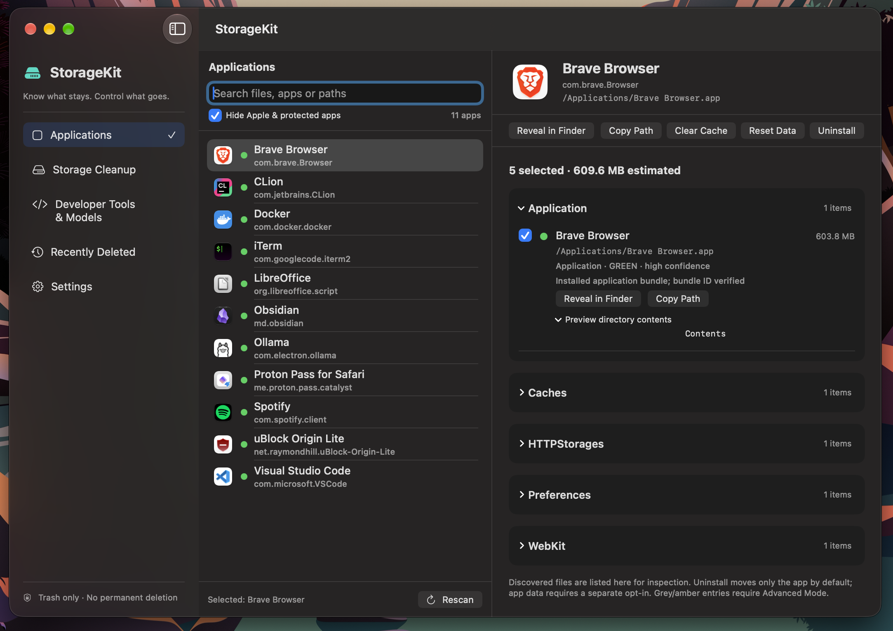
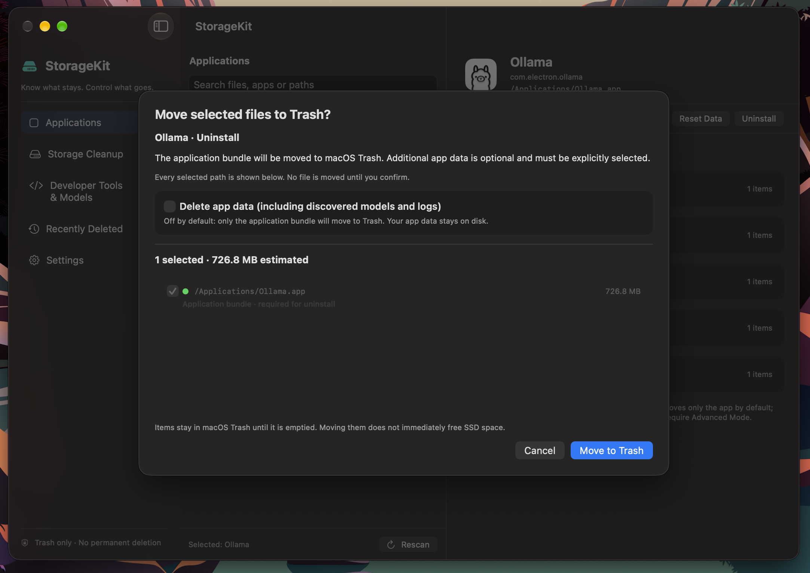
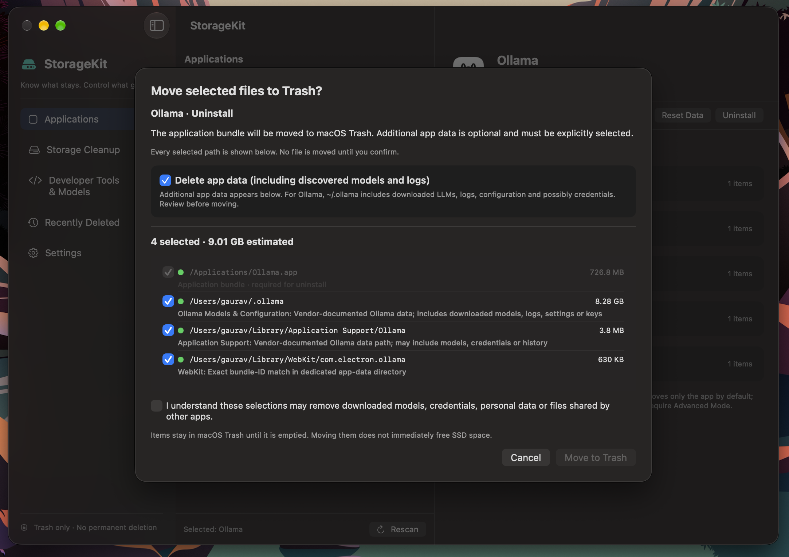
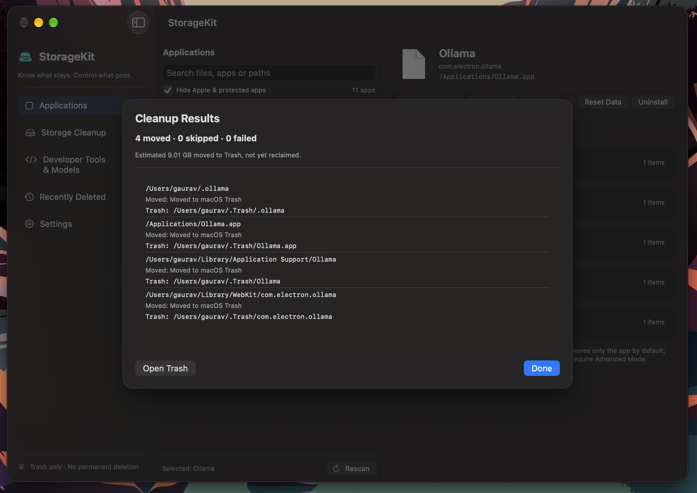
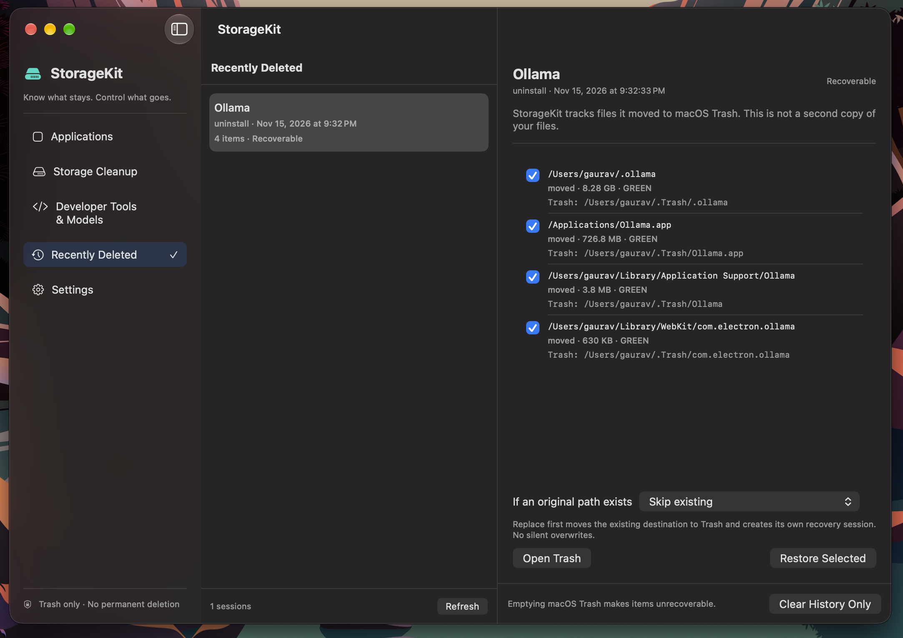

# StorageKit

**Know what stays. Control what goes.**

<p align="center">
  <a href="https://github.com/naga251602/storagekit-macos/releases/download/v0.1.0/StorageKit-v0.1.0-macos-arm64.zip"></a>
  <a href="https://github.com/naga251602/storagekit-macos/releases">All releases</a>
</p>

**First launch:** Choose **Accept Default Settings** or **Customize** to select review folders individually. See [First-run guide](docs/FIRST_RUN.md).

**Auto-updates:** Sparkle requires a signed update feed and notarized release. See [Release and update guide](docs/RELEASES_AND_AUTO_UPDATES.md).


StorageKit is a **native macOS application and storage cleanup utility** built with **C++20** (read-only discovery) and **SwiftUI/AppKit** (interface and Trash/recovery operations). It locates installed applications and their related user data, inventories developer runtimes and local AI models, and gives you a path-by-path review **before** moving anything to macOS Trash.

> **Release:** v5.4.1 · **Platform:** macOS 13+ / Apple Silicon (M-series) · **Status:** source build for local use. Native build, full permissions behavior, and real Trash/restore actions must be tested on your Mac. The automated fixture tests do not prove those operations are safe on a live system.

## Screenshots

A quick look at StorageKit's application discovery, review-before-removal workflow, and recovery experience.

### Application browser

<p align="center">
  
</p>

### Uninstall review

By default, StorageKit proposes moving **only the application bundle** to Trash. Related files appear for review only when **Delete app data** is enabled.

<table>
  <tr>
    <th align="center">App only (default)</th>
    <th align="center">App + selected data (opt-in)</th>
  </tr>
  <tr>
    <td align="center"></td>
    <td align="center"></td>
  </tr>
</table>

### Cleanup results and recovery

<table>
  <tr>
    <th align="center">Move to Trash results</th>
    <th align="center">Recently Deleted / restore</th>
  </tr>
  <tr>
    <td align="center"></td>
    <td align="center"></td>
  </tr>
</table>

> Screenshots illustrate the app's review and recovery flow. Files moved to macOS Trash remain there until Trash is emptied.

## Why it exists

Dragging `Example.app` to Trash generally removes the application bundle, **not** necessarily its preferences, logs, caches, application-support data, or downloaded models. Those files can live in several `~/Library` folders and, for developer tools, in hidden home folders. StorageKit helps you *see* the locations, distinguish verified from uncertain matches, and choose what to remove. It never promises exhaustive discovery or that a matched folder is disposable.

## Features

| Screen | What you can do |
| --- | --- |
| **Applications** | Find third-party apps and optionally reveal Apple apps; inspect paths and sizes; **Clear Cache**, **Reset Data** or **Uninstall** with a detailed confirmation. |
| **Storage Cleanup** | Inspect app caches, old logs/downloads, Xcode DerivedData and leftover Ollama data. Add your own files or folders for review. |
| **Developer Tools & Models** | Inspect known Python/Node environments, runtime versions, package caches, Hugging Face repositories and Ollama/LM Studio model stores. Choose supported user-owned locations for Trash. |
| **Recently Deleted** | Review the actual Trash results and restore still-recoverable items to their original locations. Fully restored sessions disappear. |
| **Settings** | Reopen the permissions walkthrough; choose **Standard** or **Advanced** selection; manage review folders; configure GitHub feedback links. |

### Classification and selection

- **Green — verified third-party:** Exact, known per-app user location. May be initially selected for review, but **not automatically deleted**.
- **Grey — unknown:** Ownership uncertain, or a manually chosen path. Normally needs explicit selection / Advanced Mode.
- **Amber — caution:** Shared or Apple app-owned user data. Apple app data is **unselected** and needs **Advanced Mode** plus explicit risk confirmation.
- **Red — protected:** System location or otherwise disallowed. Never moved by StorageKit.

Colors describe confidence/risk, **not** whether a file is safe to erase. The app rechecks file identity before each move.

## Installation & first launch

### Requirements

- Mac with Apple Silicon (M1/M2/M3/**M4** or newer)
- macOS 13 Ventura or newer
- Xcode Command Line Tools or Xcode with `clang++`, `swiftc`, `codesign` and `iconutil`
- Python 3 for the optional scanner unit tests

### 1 — Extract and build

```bash
cd ~/Downloads
unzip storagekit-v5.4.1.zip
cd storagekit-v5.4.1

xcode-select --install     # Only if Command Line Tools are not installed
chmod +x build.sh
./build.sh
```

A successful build prints:

```text
Built: build/StorageKit.app
Run: open "build/StorageKit.app"
```

**Open the correct application name:**

```bash
open -n "build/StorageKit.app"
```

Do **not** open `Mac App Cleaner.app` from an older release. If you extracted into a different folder, run commands from the directory that contains `build.sh`.

The script builds the C++20 scanner and SwiftUI executable, installs the icon and README inside the bundle, and **ad-hoc signs** the app for local use. Ad-hoc signing is **not** Apple Developer ID signing or notarization. This script targets Apple Silicon only and is not a universal binary.

### 2 — Welcome & permissions

At first launch, the wizard guides you through **Welcome → Choose Folders → Full Disk Access → Ready**, with separate **Back** and **Continue** buttons.

1. **Welcome:** Read what StorageKit discovers and what it can move to Trash.
2. **Choose Folders (optional):** Add directories whose immediate children you want available for **Storage Cleanup**. They are **not preselected**.
3. **Full Disk Access (optional):** Use the provided link to **System Settings → Privacy & Security → Full Disk Access**. macOS requires that **you grant access manually**. Restart StorageKit if you change permissions.
4. **Ready:** Finish the wizard and load apps.

Reopen this walkthrough later from **Settings → Review Access Setup**. Granting access does not authorize deleting system files. StorageKit does not request `sudo` or bypass System Integrity Protection.

## Application cleanup workflow

1. Open **Applications** and select an app. StorageKit scans its `.app` bundle and related user Library locations.
2. The app's icon, name, bundle ID and path appear in the **top-right inspector header**. A compact, **single-row** action toolbar contains **Reveal in Finder**, **Copy Path**, **Clear Cache**, **Reset Data** and (for third-party apps) **Uninstall**. Narrow windows scroll the action toolbar horizontally, rather than wrapping it.
3. Expand directory groups to review file paths and sizes. Check only items you want to include.
4. Choose an action. The confirmation sheet lists the **actual paths**, selection state, size estimates and any warnings.
5. Click **Move to Trash** to proceed. Nothing is moved by merely opening a sheet.
6. Check results and use **Recently Deleted** to restore items if they're still in macOS Trash.

### What each action does

| Action | Scope | What's preserved |
| --- | --- | --- |
| **Clear Cache** | Selected verified/reviewable app-specific `~/Library/Caches` items | Application bundle, settings and non-cache data |
| **Reset Data** | Selected app-specific cache **and** data items (such as preferences/support/containers) | Application bundle |
| **Uninstall** | Initially **only** the `.app` bundle | Associated app data, unless you enable **Delete app data** |

**Uninstall deliberately starts with “Delete app data” unchecked.** Enabling it reveals additional files; you review which ones to include. Turning it off again removes all those data files from the pending action. App data resets can remove local downloads, sign-in state, unsynced work or other valuable information. Credentials stored in Keychain or remote accounts may remain. The app won't guarantee a complete factory reset.

### Apple app cache/data cleanup (new in v5.4)

Apple system apps are hidden from the app browser **by default**. Uncheck **Hide Apple & protected apps** to see Apple apps (including those under `/System/Applications`). Their `.app` bundles stay **read-only**; **Uninstall is never offered for Apple apps**.

To review Apple user data:

1. Go to **Settings → File Selection Mode → Advanced**.
2. Back in **Applications**, turn off **Hide Apple & protected apps**.
3. Select an Apple app. StorageKit searches for **exact bundle-ID matches** inside known per-user `~/Library` folders (Caches, Preferences, Application Support, Containers, Logs, Saved Application State, HTTPStorages and WebKit).
4. Explicitly check a corresponding **amber** file or folder, then use **Clear Cache** or **Reset Data**.
5. Read the warnings, review each selected path and acknowledge the risk before moving anything to Trash. **Quit the target app first.**

**Important:** Apple app data may include browser profiles, messages, documents, sync state, Photos/Mail content, or iCloud-backed information. Resetting it can cause data loss or resynchronization problems. StorageKit does **not** auto-select Apple app data, delete `/System` or `/Library` content, or attempt to clean Apple shared group containers and system services. Some Apple app data uses nonstandard locations and will not be detected. Even with Full Disk Access, protected or unowned paths remain blocked. Use the app's built-in reset/clear functionality where available.

## Storage Cleanup

- **App caches:** High-confidence third-party caches can be checked for review.
- **Xcode DerivedData, user logs, older downloads:** These may be valuable. Require Advanced Mode / manual review in relevant cases.
- **Ollama remnants:** `~/.ollama` may contain downloaded models, logs, configuration and **keys**. Treat it as high-risk, especially if Ollama is still in use.
- **Add Files or Folders…:** Use the macOS picker to choose ordinary user-owned paths; items are initially unchecked, require a second selection and an exact-path confirmation.

StorageKit refuses to Trash whole system roots, the entire home folder, symlinks, StorageKit's own recovery metadata, and other protected locations. User-selected directories may contain **all their nested files**. Review them carefully. Storage cleanup frees **disk storage only after Trash is emptied**; it does not clear RAM.

## Developer Tools & Models

Discover known local runtime installations and caches such as Python `pyenv`/Conda/uv, Node `nvm`, npm/pip/Hugging Face caches, Ollama model storage and LM Studio models. Supported user-owned folders have checkboxes and **no automatic selection**. Inspect the selected directory and click **Move Selected to Trash** for a second confirmation.

Not all tools support safe raw-file removal. **Homebrew-installed packages and individual Ollama manifests are read-only in StorageKit**: use `brew uninstall …` or `ollama rm …` through their own manager. Trashing an entire Ollama model store removes **all** locally downloaded models, not just one. Stop running tools and servers before modifying their data. Custom model locations may need manual selection in Storage Cleanup.

## Recently Deleted / restoring files

StorageKit uses Foundation's native macOS Trash operation (`FileManager.trashItem`). The app records a local manifest (not a second backup copy) at:

```text
~/Library/Application Support/StorageKit/history-v1.json
```

The history keeps original paths, actual Trash destinations, file identity, timestamps and outcomes. Select recoverable items and choose **Restore Selected**. If the original destination exists, choose to **Skip**, **Restore with new name**, or **Replace** (which first moves the existing destination to Trash and records a separate history entry). A session is removed from Recently Deleted when every moved item is restored.

If Trash is emptied or items are removed externally, recovery may be impossible. **Moving to Trash does not immediately increase available SSD space.** You empty Trash yourself; StorageKit does not offer permanent deletion.

## Privacy and safety

- No telemetry, cloud upload, background scans, silent deletions or privileged helpers.
- Scanner is **read-only** and produces JSON Lines; Swift revalidates path, ownership, device/inode, modification time, symlinks and allowed location when moving an item.
- A running app blocks app-targeted cleanup. Some headless servers may not be detected: stop them yourself.
- Apple-protected locations remain blocked even if Full Disk Access is enabled.
- Shared, unknown and Apple app-specific user files require manual review; Apple cleanup additionally requires Advanced Mode.
- Cleanup may be partial if macOS refuses access or files change after scanning. Read the results screen.

**Never test removal on important data first.** Start with a disposable app, cache or temporary file, then verify Trash and restore behavior on your actual Mac.

## Development

### Source layout

```text
engine/Scanner.cpp                C++20, read-only application/inventory/storage scanner
app/Models/                      Scan results, classification, cleanup actions, history
app/ViewModels/CleanerModel.swift App navigation, selections and workflow
app/Views/                       SwiftUI sidebar, app inspector, review, setup, restore
app/Services/                    Native Trash, restore, permissions, settings, history
assets/                           StorageKit app icon / iconset
tests/test_scanner.py             Portable non-destructive scanner fixtures
scripts/test.sh                   Scanner tests and Swift parser
scripts/format.sh                 Formatting utilities
build.sh                          Native Apple Silicon build and ad-hoc signing
docs/                             Architecture, permissions, safety and test guidance
.github/                          CI and GitHub issue forms
```

### Automated CI and releases

This repository includes GitHub Actions for **Linux scanner/UI regression tests**, a **native Apple Silicon build**, bundle/signature verification, downloadable CI build artifacts, and **tag-based GitHub prereleases** with SHA-256 checksums.

- CI: `.github/workflows/ci.yml` — push to `main`, pull requests, and manual runs.
- Release: `.github/workflows/release.yml` — push a tag such as `v5.4.1` to build and publish an arm64 prerelease.
- Details and GitHub setup: [`docs/CI_CD.md`](docs/CI_CD.md).

Automated checks cannot validate the actual SwiftUI window positioning or macOS Trash restore operations. Native releases are currently **ad-hoc signed, not notarized**.

### Run tests

```bash
./scripts/test.sh
# Or only the scanner fixture suite:
python3 tests/test_scanner.py -q
```

### Read-only scanner CLI

```bash
SCANNER="build/StorageKit.app/Contents/Resources/storagekit-scanner"
"$SCANNER" list --jsonl
"$SCANNER" list --include-apple --jsonl  # Opt-in Apple app inventory
"$SCANNER" scan --path "/Applications/Example.app" --sizes --jsonl
"$SCANNER" inventory --sizes --jsonl
"$SCANNER" storage --sizes --jsonl
```

The scanner cannot Trash anything by itself. If native compilation fails, attach your **full compiler output** when reporting a bug, and include the macOS version and command that produced it (redact private paths before posting publicly).

### References

- [Permissions](docs/PERMISSIONS.md)
- [Safety model](docs/SAFETY.md)
- [Architecture](docs/ARCHITECTURE.md)
- [macOS smoke-test checklist](docs/TESTING.md)
- [v5.4 UI notes](docs/UI_V54.md)
- [Changelog](CHANGELOG.md)
- [Contributing](CONTRIBUTING.md)

## Contributing, GitHub and licensing

For **Request Feature / Report Bug**, enter the published GitHub repository URL in Settings. The included `.github/ISSUE_TEMPLATE/` files provide the forms; StorageKit does not automatically submit any files, diagnostics or private logs.

Suggested repository: `storagekit-macos` (availability not checked). **License not yet selected**; publishing source files alone does not grant reuse rights. Add the license you choose before accepting outside contributions.
